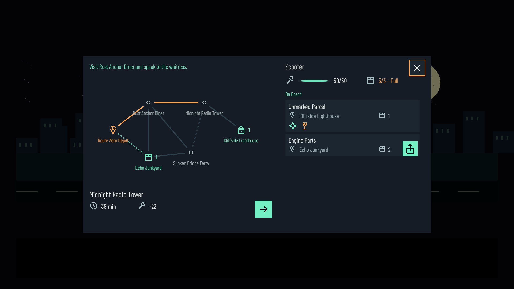

# 《零号夜航》· 策划案2.0可玩原型

游戏内文字统一为英文，主菜单、设置、地图、货物、事件、对话与结局使用项目内的 **Barlow Condensed Light**（`Assets/Art/Fonts/BarlowCondensed-Light.ttf`）。原型控制器在场景中直接引用此字体，面板生成工具也使用同一个字体资源。

Unity **2022.3.62f3c1**。打开 `Assets/Scenes/MainMenu.unity` 点击开始游戏，或直接运行 `Assets/Scenes/GamePlay.unity`。

## 当前流程

六个节点：零号快递站、锈锚餐厅、回声废车场、沉没大桥渡口、午夜广播塔、断崖灯塔。七件快递、三种载具、十种事件；不使用“送四件获胜”或耐久归零Game Over。

- **停靠**：画面保留剪影舞台与电影黑边字幕。按 **E** 或点击「继续」阅读对话；鼠标点击委托人可交谈。对话和规划不消耗游戏时间。
- **地图与后备箱**：按 **Tab / M** 或点击当前车辆打开；再次按Tab或Esc关闭。左边可选择任意已开放目的地，自动按当前载具预计耗时最短规划，整条路线高亮显示；右边查看车况与货物；没有待取件时会收起该区，扩展车上货物列表。可将待取件拖入后备箱，也可点「装车」。
- **途中停靠与改道**：跨站路线逐段行驶，每段正常扣除资源并触发事件。途经站点会停靠、签收并进入对话；对话后按E或字幕箭头继续原目的地，或打开地图选择新目的地。可随时折返已开放站点。耗时/损耗是按当前配载估算，不包含随机事件；途中换车、配载后会重新计算剩余路线。灯塔仍保留真相、钥匙与旧皮卡的剧情门槛，点击可查看具体原因。
- **幽灵**：没有待继续行程时，在车辆内按E下车，用WASD移动，靠近NPC按E交谈；靠近已解锁废弃车辆按E附身。也可在合并面板中附身、维修。
- **公路**：自动巡航，实时推进时间并消耗耐久。事件暂停模拟，两个选项直接标注时间、耐久与货损代价。游戏暂停仍用Esc进入原有菜单。
- **交付**：抵达收件站自动签收并进入节点对话。主线磁带和钥匙通过对话自动交给玩家；目的地在快递卡与地图收件图示/数量上显示。

主线顺序：餐厅领取磁带 → 渡口取得钥匙 → 广播塔交付磁带并与DJ交谈 → 附身旧皮卡 → 风暴公路 → 断崖灯塔。引擎零件送到废车场后解锁单车，便于完成重货与支线。

## 简短新手引导

画面上方的英文提示依操作推进：交谈 → 打开地图 → 装货 → 选目的地 → 出发 → 事件抉择 → 首次抵达。细框标出当前可操作的按钮；可随时点 Skip，抵达后也可点 Done 收起。首次抵达后再打开地图或继续出发，会自动结束引导。引导不锁路线、不强制装货，也不额外推进游戏时间；完成或跳过后，本轮不再出现。重新加载游戏场景会重新开始引导。

提示条与高亮框共用 `Assets/Prefab/UI/CourierTutorial.prefab`，可直接调整布局和样式；阶段与英文提示在 `CourierTutorial` / `CourierTutorialView` 中维护。

## 对话实现

当前只保留夜航节点对话：正文与剧情交接在 `NightCourierModel.cs` 的 `CourierRun.TalkToNpc()`，展示与E键推进在 `NightCourierPrototype` / `CourierHudPanel`。旧模板对话管理器、独立面板、表格、对话编辑器和专用Excel导入器已移除，避免维护两套流程。通用存档和通用Excel导表工具保留；夜航剧情目前没有接入持久存档。

## 载具与资源

| 载具 | 获取 | 载重 | 耐久 | 能力 |
| --- | --- | --- | --- | --- |
| 滑板车 | 初始 | 3 | 50 | 轻便，不能装重货 |
| 单车 | 废车场，交付引擎零件后 | 8 | 120 | 可装重货，容量最大 |
| 旧皮卡 | 广播塔，交付磁带并完成真相对话后 | 4 | 80 | 可装重货，碎石路保护易碎件 |

载重达到容量时，耗时×1.35、损耗×1.65；最多允许超载2格。每辆车分别保留耐久。维修免费，消耗12游戏分钟。支线件可寄存在任意节点，之后回到该节点重新装车；主线件不能丢弃。切换容量更小的车之前，需要先寄存多余支线件。

- 【限时】：从首次装车开始计时；等待接取的货物不会预先过期。
- 【易碎】：碎石路或危险事件会损坏；旧皮卡仅保护碎石路颠簸，无法阻止事件伤害。
- 【重货】：单车及旧皮卡可承运。
- 【保持干燥】：过河等事件中不采取防水措施会受损。
- 浓雾、河流、风暴作为路段环境与相应事件处理。

## 容错与双结局

- **抛锚**：幽灵自动推车至当前目标节点，只让当前限时支线件超时；主线包裹不会消失。到站临时修复至35%耐久，让后续路线仍可出发。
- **天亮**：全夜预算240游戏分钟；超时仍允许继续主线，不弹失败死档。
- **风暴公路**：广播塔真相、钥匙与旧皮卡齐备后开启。最后路段独立限时30游戏分钟，超时也能继续到达。
- **结局A · 完美送达**：夜间与最终路段均未超时，无名包裹完好，四份支线均成功交付。
- **结局B · 公路守望者**：抵达终点时未满足A条件，包括超时、包裹受损或放弃支线。

原型巡航速率为现实1秒推进0.3游戏分钟；15分钟为设计目标，尚需真人试玩校准阅读、规划与巡航节奏。自动化检查会快进模拟，不代表真实通关耗时。

## 可编辑资产

实际使用的原生uGUI面板位于 `Assets/Resources/Panel/Courier/`：

| Prefab | 内容 |
| --- | --- |
| `CourierHudPanel.prefab` | 停靠字幕、E继续；行驶时的居中倒计时与进度条 |
| `CourierRoutePanel.prefab` | 合并地图、载具状态、待取件、后备箱、附身、维修和出发 |
| `CourierEventPanel.prefab` | 两选一事件卡 |
| `CourierResultPanel.prefab` | A/B结局文本、重开、主菜单 |

主地图面板尺寸为1300×660，主要图示为32–40，线宽加粗。英文站名为28号，货物名称为32号，目的地、重量和限时数字为28号；站名允许两行，并分布在节点外侧避开公路线；目的地名称和标记均可点选。货物卡与待取区高度适配放大后的字号。地图已标注当前位置，因此移除重复站名；载重只显示数值与满载状态，不再重复绘制进度条和独立警告。满耐久时隐藏维修按钮，无特殊标签的货物卡自动缩短，空的待取区会收起。货物保留独立滚动区。

面板已改为统一的原生矢量图示：扳手表示耐久/维修，箱子表示载重/收件，时钟表示时间，星光表示主线，玻璃杯表示易碎，砝码表示重货，雨伞表示干燥要求。关闭、装车、寄存、出发、继续、重开和主菜单使用图示；滑鼠悬停或方向键选中时显示具体名称、条件与代价。货物名、收件站、当前任务、道路风险和事件行动仍保留文字。

图示在 `CourierIconGraphic` 的 Kind 中选择，线条与颜色可在Prefab中修改，不依赖字体符号或外部图片。`CourierTooltip` 统一显示提示；地图、物品卡、事件选项共用这套图示。

单件货物卡：`Assets/Prefab/UI/CourierCargoRow.prefab`。旧版Cargo/Vehicle面板资产暂保留以兼容此前布局参考；运行入口已经合并，不再加载独立窗口。

`Assets/Resources/NightVoyage/` 中的UTF-8 CSV会在新游戏与重开时读取：

- `Vehicles.csv`：名称、能力文案、载重、耐久、速度和损耗倍率。
- `Parcels.csv`：七件快递的名称、重量、酬金、易碎/重货/干燥要求、时限。
- `Events.csv`：十个事件的标题、说明、选项文字、耗时、耐久和货损结果。按钮代价从数值生成，修改数值后不用手改按钮代价文字。

保留列名和稳定ID；任务起终点、主线身份与剧情门槛在 `NightCourierModel.cs` 定义。参数修改后请重开并重新检查完整路线。编辑器菜单 `Tools > Night Courier > Rebuild UI Prefabs (overwrite layouts)` 会覆盖面板布局，但不会覆盖已存在的CSV。平时直接编辑Prefab即可。

可在场景的 `NightCourierPrototype` 指定UI字体和正式电台音乐。当前六站地标、三辆载具、车灯光束、雨雾均为Canvas几何占位；声音使用程序生成的临时电台、风声、引擎、调频与附身提示，并接入现有音量混音器。尚未替换正式美术、配音、歌曲或URP Light 2D资产，也尚未制作提交视频与比赛构建包。

## 本次采用的策划口径

1. 载具名称及数值以3.4.1表格为准，暂不采用剧情段落中的“美式旧皮卡/幽灵跑车”；重货权限按解锁阶段处理。
2. 快递以3.4.2的七件清单为准，事件池取十个。
3. 引擎零件设为2格普通货，确保初始滑板车能够送达以解锁单车；4格重货为一箱告别信。
4. 主线件自动接收，空间不足时把支线件寄存在当前站；受损主线件仍会推进剧情，避免死档。
5. “多雾阶段”作为环境处理；“敌对领地”尚无具体对应快递，当前由浓雾精灵事件表现，没有另加一套领地标签机制。
6. 240分钟夜间预算、30分钟风暴路段、12分钟维修、推车后35%临时修复，以及A结局要求四支线完成，均为把策划闭环落地的初始参数。

## 验证

- `Tools > Night Courier > Run Rule Checks`：673项断言，新增引导推进、跳过和自由行动，新增任意开放节点互达、最短耗时路线、途中等待/继续、改道与行程抛锚恢复，包含七件完整派送的A结局、放弃支线/夜间超时/最终路段超时的B结局、解锁门槛、重货、干燥与易碎事件、寄存、主线交接腾空间、推车恢复、50组冒险与超时主线。
- Unity入口 `-executeMethod NightCourierPanelSmokeTest.Run`（不带`-quit`）：24步真实场景检查，含引导逐步推进、原生Skip点击、跨站选点与整段高亮、途中继续按钮、原生拖拽命中、合并面板、对话、附身、暂停、双结局与抛锚恢复，保存 `/tmp/courier-v2-*.png`。
- `GameFlowSmokeTest.Run`：原有开始、暂停、设置、重开、返回菜单等15步回归。

首次试玩重点：玩家能否从字幕理解当前主线；能否看懂地图收件站与车上货物；是否主动为重货换车、为干燥件选择稳妥事件；遭遇抛锚后能否继续看到结局。上述测试尚不能证明真人通关率或15分钟体验目标。
