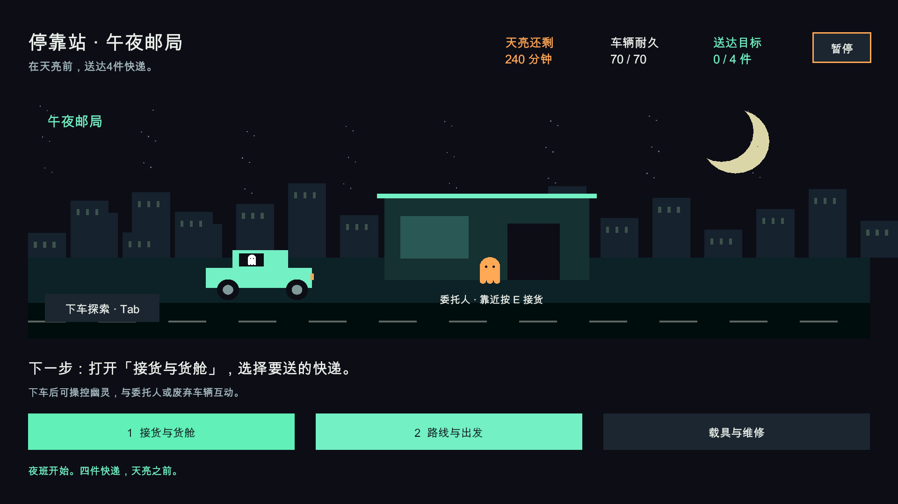

# 亡灵夜递 · Unity 玩法原型

Unity **2022.3.62f3c1**。打开 `Assets/Scenes/MainMenu.unity` 点击「新游戏」，或直接运行 `Assets/Scenes/GamePlay.unity`。
编辑器菜单 `Tools > Night Courier > Open Prototype` 也可打开玩法场景。

## 操作与目标

在天亮前的 **240游戏分钟** 内成功送达 **4件** 快递。停靠与规划不消耗时间；公路上现实1秒推进4游戏分钟，事件选择时暂停。免费维修消耗12游戏分钟。

主画面只保留场景、倒计时、耐久、送达进度，以及明确的下一步提示。

1. 点「接货与货舱」：左栏是本站待取，右栏是已装上车；每件快递单独列出目的地、重量、报酬与要求。点「装上车」接货。
2. 点「装好了，选路线」：打开路线面板，选择相邻站点，右侧查看耗时、耐久消耗、路况风险，再点「确认路线，出发」。也可以空车出发。
3. 路上自动巡航，遇到事件后在独立弹窗中选择处理方式。
4. 到站自动签收。需要换车、修车时打开「载具与维修」。

**Tab** 上下车；幽灵用 **WASD / 方向键** 飘移，靠近委托人或废弃车辆按 **E** 打开相应面板。**M** 打开路线面板。**Esc** 优先关闭规划面板；没有规划面板时进入原有暂停菜单。事件与结算需通过面板按钮处理。

## 可编辑的 UI Prefab

所有 UI 都是原生 uGUI 的 `Text / Image / Button / ScrollRect`，使用现有 `BasePanel / UIManager`。运行时加载已保存的 Prefab，布局和按钮引用在 Prefab 内序列化；不再使用 IMGUI 绘制界面。舞台和公路线条也改为原生 Canvas Graphic，确保弹窗能正确遮挡和拦截点击。

双击 `Assets/Resources/Panel/Courier/` 下的 Prefab 进入编辑模式：

| Prefab | 内容 |
| --- | --- |
| `CourierHudPanel.prefab` | 主画面：场景、关键状态、下一步提示、三个功能入口 |
| `CourierCargoPanel.prefab` | 接货与货舱：本站待取 / 已装上车、载重、装卸货、前往选路 |
| `CourierRoutePanel.prefab` | 路线：可选站点、路况连线、耗时与耐久代价、出发按钮 |
| `CourierVehiclePanel.prefab` | 载具：当前车辆 / 可附身车辆、属性、附身与维修 |
| `CourierEventPanel.prefab` | 公路事件：说明与两个明确标注代价的选项 |
| `CourierResultPanel.prefab` | 夜班结算：送达件数、收入、用时、重开与主菜单 |

单件货物的复用卡片在 `Assets/Prefab/UI/CourierCargoRow.prefab`。面板脚本位于 `Assets/Scripts/Prototype/UI/`，Inspector 中的字段引用已绑定；静态标题和按钮文案可直接改子对象 Text，动态状态由对应脚本更新。需要统一字体时，可在场景的 `NightCourierPrototype` 上指定 UI Font；未指定时会使用系统中文字体。

面板路径已注册到 `Assets/Resources/Data/UIDataListSO.asset`。可直接运行 GamePlay 检查修改。编辑器菜单 `Tools > Night Courier > Rebuild UI Prefabs (overwrite layouts)` 仅供重新生成默认布局，**会覆盖面板布局修改，平时编辑 Prefab 不需要执行**。

## 初始测试参数

原描述提到的3.4.1车辆表尚未提供，下表为原型假设，可在 `NightCourierModel.cs` 调整。

| 载具 | 容量 | 耐久 | 速度倍率 | 损耗倍率 | 能力 / 获取地点 |
| --- | --- | --- | --- | --- | --- |
| 轻型轿车 | 4 | 70 | 1.2 | 1 | 起始车辆，不能装重货 |
| 旧皮卡 | 8 | 100 | 1 | 0.9 | 废车场，解锁重货 |
| 重型货车 | 12 | 140 | 0.8 | 0.65 | 南山墓园，碎石路保护易碎件 |

载重达到容量即触发满载惩罚：耗时×1.35、损耗×1.65。最多允许超载2格。各车辆耐久分别保留，换车不能刷耐久；货物随附身转移。

- 【限时】：以本班开始时为基准的绝对截止时间，装车面板显示剩余时间；超时失败且腾出载重。
- 【易碎】：轻型轿车和皮卡走碎石路会损坏；货车减震仅保护碎石路，不能防止事件中急刹或硬闯的损坏。破损件到目的地被拒收。
- 【重货】：只有皮卡和重型货车可装载。
- 每段路中途随机出现三种事件之一。稳妥处理花时间，冒险处理扣耐久，部分冒险选项会损坏易碎件。
- 天亮、耐久耗尽，或剩余可完成订单不足以达成4件时失败。

## 内容与验证

7个节点、10条双向道路、8件快递、3种事件、3辆载具；节点停靠舞台、幽灵移动、视差巡航、地图配载、维修、日志及结算均可操作。美术使用运行时几何占位，UI使用原生uGUI Prefab与现有Canvas缩放，适合桌面原型；未制作正式美术、音效、移动端适配或持久化进度。

`NightCourierModel.cs`：独立规则与数据；`NightCourierPrototype.cs`：输入与面板调度；`UI/`：各面板绑定及Canvas舞台绘制；`NightCourierChecks.cs`：独立规则回归检查。

- `Tools > Night Courier > Run Rule Checks`：验证59个断言，含完整成功路线、往返、重货限制、超载、期限、维修代价、换车耐久、破损、事件暂停、天亮和损毁失败。
- Unity入口 `-executeMethod NightCourierPanelSmokeTest.Run`（不带 `-quit`）：验证原生面板加载、装卸货显示、实际点击命中、面板切换、地图、出发、暂停、事件、交付、附身、结算与重开；在图形界面下保存 `/tmp/courier-panels-{hud,cargo,route,vehicle,event,result}.png`。
- 原有 `GameFlowSmokeTest.Run` 继续验证主菜单、设置、胜负、重开与返回流程。

建议首次试玩5–10分钟：观察玩家能否自主说明为什么选某条路、是否愿意绕路取皮卡、是否理解满载与易碎代价。先验证这些选择是否有意义，再扩大地图和内容量。尚待确认：正式车辆表、目标单局时长与最终美术方向。
